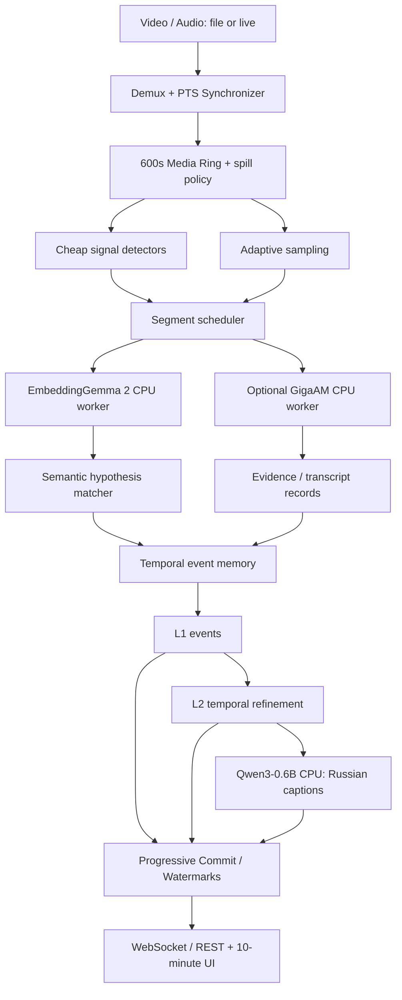

# Workspace.md — Streaming Hierarchical Semantic Decoder (SHSD)

> **Статус:** архитектурная спецификация PoC, версия `0.1`, 25.10.2026.  
> **Связанные документы:** [Todo.md](./Todo.md) — очередность работ и критерии приёмки; [Agents.md](./Agents.md) — правила и контракты работы coding-агентов.  
> **Источник требований:** принятое проектное решение — **без обучения и дообучения, без сбора обучающего датасета, все веса заморожены; инференс локально на CPU**.

## 0. Коротко о проекте

SHSD — локальный потоковый интерпретатор аудио и видео. Он держит **скользящее окно истории до 600 секунд**, извлекает эмбеддинги звука и изображения, обнаруживает смысловые изменения и **асинхронно публикует всё более подробные описания на русском**.

Центральная идея: **не пытаться каждый раз прогонять 10 минут через генеративную AV-LLM**. Вместо этого хранить события и свидетельства на шкале времени, извлекать новое только на изменениях и отдельно генерировать читаемый текст.

**Обязательные компоненты PoC:**

- `EmbeddingGemma 2` (`google/embeddinggemma-2`) — замороженный мультимодальный энкодер; представления аудио, изображений, видео и текста в совместимом пространстве размерности **768**.
- `Semantic Hypothesis Engine` — сопоставляет эмбеддинги с **заранее определёнными русскими/английскими текстовыми гипотезами**, не пытается переводить векторы напрямую в токены LLM.
- `Temporal Event Memory` — журнал наблюдений, гипотез, изменений, таймкодов и их версий.
- `Qwen3-0.6B` (локальный CPU runtime, предпочтительно GGUF/`llama.cpp`) — превращает **подтверждённые структурированные сведения** в русский текст. Это *не* мультимодальный декодер.
- `GigaAM` — необязательный независимый ASR для реплик; **не используется как единственный источник музыкальных/акустических сведений**.
- `Progressive Commit` — независимые уровни L0–L3, очереди, cursor/watermarks и обновление описаний без блокировки ввода.

**Не входит в первую версию:** обучение projector, LoRA, создание нового датасета, подача 768d embedding напрямую в Qwen, внедрение NCM как готовой мультимодальной нейросети, облачные API как обязательная часть.

---

## 1. Главные архитектурные решения

| ID | Решение | Обоснование |
|---|---|---|
| ADR-001 | Все веса готовых моделей заморожены | Нужен максимально быстрый PoC без стадии обучения |
| ADR-002 | Только CPU в целевом runtime | Главный пользовательский критерий; GPU можно применять для локальных измерений, но нельзя делать обязательной |
| ADR-003 | Между EmbeddingGemma и Qwen — **структурированная семантика**, не случайный projector | Эмбеддинги нельзя считать текстовыми токенами; необученная проекция смысла не передаст |
| ADR-004 | Progressive L0–L3 по мотивам NCM — уровень **оркестрации** | NCM генерирует иерархические текстовые коды в обученном генераторе; готовой AV-связки нет |
| ADR-005 | Хранить аудио/видео PTS и интервал каждого события | Нужна проверяемая связь с источником и корректные версии |
| ADR-006 | Отдельные курсоры захвата/эмбеддингов/черновиков/подтверждений | Асинхронные уровни нельзя свести к одной позиции |
| ADR-007 | Детализировать **изменения**, а не пересказывать непрерывно одну сцену | Экономия CPU, меньше повторений |
| ADR-008 | Нельзя делать вид, что embedding similarity = достоверная вероятность | Нужны пороги отказа, отрицательные гипотезы и прозрачные свидетельства |
| ADR-009 | Сначала измерять задержки на настоящем CPU | Нельзя заранее обещать realtime только из-за асинхронной архитектуры |

### 1.1. Что означает «вдохновлено NCM»

В исходной работе [HazyResearch/ncm](https://github.com/HazyResearch/ncm) Next-Concept Modeling (NCM) генерирует текст **от грубых уровней к детальным**, предсказывая позиции **параллельно внутри уровня** при использовании обученных residual-VQ кодов. У нас **нет** обученных AV↔NCM соответствий, а опубликованные speedup не доказывают ускорения нашей системы на CPU.

Мы заимствуем **только дизайн пользовательского взаимодействия и pipeline**: ранние грубые события доступны сразу; последующие шаги уточняют их; разные временные интервалы могут обрабатываться независимо. Не называем наши структурированные события VQ-токенами NCM.

### 1.2. Условия успеха и ограничения

**Функциональная цель:** на видео со звуком получать отдельные события по визуальному ряду, музыке, другим звукам и речи, а затем связное русское описание со ссылкой на интервалы источника.

**Вычислительная цель:** измерить режим, при котором система обрабатывает ≥1 секунды входного времени за секунду wall-clock на **указанном CPU**. До замеров это **целевой показатель, не подтверждённое свойство**.

**Результат даже при недостаточной скорости:** система корректно сообщает lag, регулирует качество, безопасно хранит backlog и не утверждает, что описано то, что ещё не обработано.

**Не обещаем:** точный BPM, тональность, идентификацию инструмента, 100% правильную связь звука с видимым объектом, детальную реконструкцию из одного embedding или гарантированную real-time работу без профилирования.

---

## 2. Проверенная технологическая база

| Компонент | Подтверждено документацией | На что нельзя полагаться без проверки |
|---|---|---|
| EmbeddingGemma 2 | 740M всего, модульные encoders, 768d общий embedding, текст/изображение/видео/аудио, 8192-token context, CPU возможен | Реальные миллисекунды/секунды для audio/video на целевом CPU; устойчивость тонких музыкальных признаков |
| Qwen3-0.6B | Открытые веса серии Qwen3, multilingual, есть non-thinking mode | Качество подробной музыки из скудного структурированного ввода; tok/s конкретного CPU |
| GigaAM | Открытый репозиторий; есть ONNX export/inference | Производительность выбранной версии ASR, точные метки без дополнительной обработки, диаризация |
| NCM | Код, чекпойнты, coarse-to-fine генерация | Работа из EmbeddingGemma-эмбеддингов, полноценный русский AV-captioning, заявленное CPU-ускорение |
| FFmpeg / PyAV | Демультиплексирование, PTS и time_base | Автоматическая синхронизация после потерь кадров без собственной логики |

**Официальные ссылки:**

- [EmbeddingGemma 2 model card](https://ai.google.dev/gemma/docs/embeddinggemma/model_card_2)
- [EmbeddingGemma 2 multimodal Sentence Transformers guide](https://ai.google.dev/gemma/docs/embeddinggemma/multimodal-embeddinggemma-with-sentence-transformers)
- [Qwen3 GitHub](https://github.com/QwenLM/Qwen3)
- [GigaAM GitHub](https://github.com/salute-developers/GigaAM)
- [NCM GitHub](https://github.com/HazyResearch/ncm)
- [PyAV time/PTS documentation](https://pyav.org/docs/stable/api/time.html)
- [llama.cpp](https://github.com/ggml-org/llama.cpp)

Пины версий библиотек/моделей фиксируются в `models.lock.json` и `uv.lock` / `requirements-lock.txt` **после запуска smoke tests**, не выдумываются заранее. Контроль `revision`, хэшей и лицензий обязателен.

---

## 3. Терминология, границы модальностей и качество

- **Capture window:** последние 600 секунд входных медиа в координатах источника.
- **PTS:** presentation timestamp; хранить `pts` и `time_base`, получать секунды как `pts × time_base` с учётом начального смещения и разрывов потока.
- **Observation:** воспроизводимое наблюдение: кадр, изменение яркости, VAD, onset, эмбеддинг и т. п.
- **Hypothesis:** человечески читаемое предположение («электронные ударные», «человек входит»).
- **Evidence:** ссылка на исходный интервал, версию энкодера и результат сопоставления.
- **Event:** объект интервала, объединяющий observation/hypothesis/status; у него стабильный `event_id`.
- **Caption:** русское описание события или последовательности событий, созданное LLM из структурированных фактов.
- **Semantic delta:** изменения относительно предыдущего подтверждённого состояния.
- **Commit:** публикация версии, прошедшей заданный уровень требований. **Не** означает объективную истинность или нулевой риск ошибки.
- **Lag:** `capture_watermark - committed_watermark`, для каждого уровня свой.

### 3.1. Уровни L0–L3

| Уровень | Содержимое | Откуда берётся | Условие готовности |
|---|---|---|---|
| **L0** | Захваченные интервалы, признаки, embeddings; без интерпретации | Ingest + feature workers | Источники доступны, признаки рассчитаны или явно помечены отсутствующими |
| **L1** | Краткие события, coarse labels, активная сцена/музыка/речь | Similarity + cheap detectors | Прошли минимальные пороги и есть evidence |
| **L2** | Уточнения инструментов/звуков/действий, изменения во времени, реплики | Многошаговые гипотезы + temporal context + ASR | Нет критических противоречий, есть допустимая уверенность или abstain |
| **L3** | Связное подробное русское описание без повторов, с таймкодами | Qwen из **только L1/L2 и evidence** | Валидна схема; нет unsupported factual claims; версия опубликована |

L0 не обязан включать ASR. L2 может содержать пометки «инструмент определить не удалось». Внешний пользователь может переключать целевой уровень и видеть соответствующий watermark.

### 3.2. Курсоры

- `C` (`capture_watermark`): последний **непрерывный** интервал, для которого медиаданные захвачены. Если только видео пришло до `t`, но аудио ещё нет, C не обязан идти туда же.
- `E` (`embed_watermark`): непрерывное покрытие необходимых для выбранного режима модальностей эмбеддингами или явными флагами пропуска.
- `D[level]` (`draft_watermark`): непрерывное покрытие событиями данного уровня.
- `R[level]` (`commit_watermark`): последний момент, до которого все обязательные интервалы получили окончательные версии данного уровня **или явный терминальный статус `gap`, `unavailable`, `dropped`, `failed` либо `skipped`**. Для UI пропуски должны быть видимы, а не маскироваться зелёной дорожкой.

В нормальной ситуации `R[L3] ≤ R[L2] ≤ R[L1] ≤ E ≤ C`; из-за исключений, выборочных модальностей и задержек это не абсолютное инвариантное неравенство для всех отдельных полей. Реализация опирается на **interval coverage**, а не вычисляет курсор как простой максимум timestamp.

### 3.3. Терминальные статусы и исправления

`captured → encoded → observed → draft → refined → committed`, плюс `failed`, `skipped`, `unavailable`, `superseded`.

- Недостающий аудиопоток — `unavailable(audio)`; не «тишина».
- ASR отключён — `unavailable(speech_text)`; не «речи нет».
- Нет уверенного кандидата — `unknown` / `uncertain`, а не наиболее близкий тег.
- Финальный caption можно пересмотреть по новой версии `rev+1`, но **никогда не перезаписывать историю без аудита**.

`WatermarkTracker` из `shsd.memory.watermarks` хранит coverage отдельно для каждой required modality и уровня. `C/E/D/R` продвигаются по непрерывным интервалам со статусом `done` или явным терминальным статусом (`gap`, `unavailable`, `dropped`, `failed`, `skipped`); отсутствующее покрытие и `pending` останавливают курсор. Более новая interval revision может разделить прежний диапазон, stale revision и старый epoch отвергаются. Snapshot содержит cursor по каждой модальности, `C/E/D/R`, lag по уровням и видимые issues.

---

## 4. Потоки данных: обзор



### 4.1. Инженерная граница процессов

Рекомендуемая структура runtime:

1. `ingest` — demux, clocks, backpressure **не ждёт** ML.
2. `signal` — дешёвые признаки, VAD, RMS, scene-change, onset.
3. `embedder` — единственный или строго ограниченное число CPU workers EmbeddingGemma.
4. `semantic` — cosine similarity и temporal state; в основном numpy/NumPy-compatible операции.
5. `asr` — GigaAM, включается независимо, не блокирует музыку и визуальное описание.
6. `narrator` — отдельный worker Qwen, короткие батчи событий, предсказуемые лимиты токенов.
7. `timeline` — единственный writer состояния и событий; рассылка обновлений.

Асинхронные Python coroutine отвечают за планирование и IO; **тяжёлый CPU-inference в process pool**, не внутри `asyncio` event loop. Число потоков `OMP_NUM_THREADS`, `MKL_NUM_THREADS`, `torch.set_num_threads`, `llama.cpp --threads` координируется для избежания oversubscription.

---

## 5. Вход и синхронизация

### 5.1. Источники

- MVP: локальный MP4/MKV c аудиодорожкой.
- Следом: RTSP / live stream с нестабильными таймкодами.
- Дополнительно: audio-only и video-only с прозрачными `modality_mask`.

Каждый поток получает `stream_id`, `source_clock`, `epoch`, `start_pts`. Изменение epoch при seek/reconnect/time discontinuity означает новую последовательность; не объединять скачки PTS в один непрерывный временной ряд.

### 5.2. Media ring

- Длина **600 секунд по медиа-времени**, не «последние N пакетов».
- Для аудио — хранить сжатые пакеты или декодированный PCM в chunks; для видео — сжатые пакеты + небольшую полосу keyframes, избегать хранения всех RGB кадров.
- Для обработки звука извлекать mono PCM 16 kHz только там, где требуется энкодеру/ASR; оригинальные параметры сохранять в метаданных.
- На каждом chunk: `stream_id`, `start_ms`, `end_ms`, `kind`, `content_hash`, `storage_ref`, `source_pts_range`.
- Медиа может удаляться только при `end_ms < C - 600s` **и** нет задач, удерживающих его по refcount/lease. Если lease не выполнен — spill в bounded temporary disk storage; если лимит достигнут, emit `dropped` + причина.
- Визуальные метки `gap`, `corrupt`, `mute`, `no_audio_track`, `reconnect` отображаются отдельно.

### 5.3. Границы интервалов

Все интервалы `[start_ms, end_ms)`, границы целочисленные миллисекунды и сохранены в одной шкале источника. Границы окон могут пересекаться; каждое окно имеет `window_id`. Дополнительный lookahead **не должен ошибочно расширять область подтверждённых событий**.

---

## 6. Adaptive sampling: экономия CPU

Начальные **гипотезы для профилирования**, не жёстко заданные константы:

| Режим | Базовый профиль | При изменениях |
|---|---|---|
| Аудио | 5 сек, overlap 2,5 сек | 2–3 сек вокруг onset/VAD transition |
| Видео | 0,5 FPS | до 2 FPS рядом со сменой сцены |
| Joint AV | отключён по умолчанию | запуск только по подтверждённому cross-modal событию |
| L3 | запрос раз в 5–15 секунд событий | дополнительные запуски после значимых новых фактов |
| Lookahead | 2–5 сек | для музыкальной структуры до 10 сек, если lag допускает |

**Cheap detectors**: RMS/loudness, spectral centroid, спектральная новизна/onsets, VAD, разность downscaled RGB кадров, смена сцены. Соседние непересекающиеся audio windows могут сравниваться по RMS, loudness, onset count, energy activity и spectral centroid; delta содержит измерения и не называет инструмент. Это не опознавание инструмента и не полноценный анализ музыки; задача — определить, **когда** тратить inference.

**Adaptive policy:**

1. Каждому участку присвоить `novelty_score` (сигнальные изменения + отличие embeddings от предыдущего accepted state).
2. При стабильной сцене пропускать часть окон, но делать редкий heartbeat-sample — иначе система «застынет» навсегда.
3. При превышении задержки сперва снижать видео FPS/joint analysis, затем частоту L2, затем частоту L3; не снижать ingestion.
4. Вести `coverage` и сообщать пользователю, что анализ деградировал.
5. При возврате из degraded режима восстанавливать качество постепенно (hysteresis).

**Осторожно:** сравнивать embeddings для обнаружения изменений можно только при совместимых профилях подготовки ввода и одинаковой версии модели; абсолютные пороги зависят от модальности и нуждаются в калибровке на небольших **ручных пробах**, а не в обучающем датасете.

---

## 7. EmbeddingGemma 2: контракт энкодера

### 7.1. Выход

Сервис выдаёт вектор `float32[768]` (или FP16 только как формат **хранения** при проверенной погрешности), normalized `L2`, по каждому короткому input window. Для аудио/видео можно дополнительно выдавать единый joint embedding; в v0 сначала раздельные audio/video vectors.

```python
# Псевдоинтерфейс, не готовая команда запуска.
class EmbeddingProvider:
    def encode_audio(self, pcm_16k_mono, interval_ms) -> EmbeddingRecord: ...
    def encode_frame(self, image_rgb, pts_ms) -> EmbeddingRecord: ...
    def encode_texts(self, candidates: list[str]) -> list[EmbeddingRecord]: ...
```

`EmbeddingRecord` обязательно содержит `model_revision`, `input_preprocess_version`, `modality`, `embedding_dim`, `norm`, `created_at`, `latency_ms`, `window_id`.

### 7.2. Модульные веса

По официальной model card полный набор — 740M: базовый text + image + audio. Для text+audio можно загружать только необходимую башню; для видео — text+vision. Нужно **измерить** два варианта: один full multimodal worker vs два частичных/раздельных. Дублирование text backbone может ухудшить память, а совместная загрузка — latency.

По умолчанию использовать реализацию через `sentence-transformers` из официального руководства. Модульность не означает, что сервер автоматически разделяет память между независимыми процессами.

### 7.3. Не смешивать типы информации

Из text–audio similarity нельзя логически заключить, что текстовый кандидат истинный. Retrieval score не калиброван как вероятность. У video embedding ограничена детализация быстрых событий. Для точного времени события требуются отдельно PTS, change detectors, окно и иногда контекст соседних окон.

---

## 8. Semantic Hypothesis Engine (без обучения)

### 8.1. Структурированная библиотека гипотез

В репозитории храним **конфигурацию естественно-языковых гипотез**, а не обучающий датасет:

```yaml
# configs/hypotheses/music.yaml (проектная схема)
category: music
axes:
  family:
    - id: electronic
      text_en: "Electronic instrumental music is playing."
      text_ru: "Играет электронная инструментальная музыка."
    - id: acoustic
      text_en: "Acoustic instrumental music is playing."
      text_ru: "Играет акустическая инструментальная музыка."
  rhythm:
    - id: steady_pulse
      text_en: "Music has a regular steady drum beat."
      text_ru: "У музыки ровный ударный ритм."
    - id: no_percussion
      text_en: "Music has no audible percussion."
      text_ru: "В музыке не слышно ударных."
```

Реализовать оси: `music_presence`, `instrument_family`, `percussion`, `bass`, `vocals`, `tempo_feel`, `energy`, `ambient_sound`, `speech`, `visual_scene`, `visual_action`, `camera`, `av_sync`. Каждая ось должна включать явные отрицательные/конкурирующие гипотезы и `unknown`.

### 8.2. Алгоритм поиска

1. Offline startup: посчитать text embeddings всех кандидатов в **той же embedding-модели**, L2 normalize, записать cache с fingerprint списка.
2. Для аудио/кадра посчитать медиа-вектор. Одновременно сначала фильтровать широкие оси `music/speech/environment`, `scene/action`.
3. Сравнить cosine similarity только с релевантными кандидатами. Для mutually-exclusive axis выбрать `top-k` + конкурентов; для non-exclusive axis независимо проверить каждый кандидат.
4. Для mutually-exclusive axis применить **margin** между конкурентами; для non-exclusive — отдельные similarity threshold и threshold margin. Требовать temporal persistence для каждого принятого кандидата; без валидации хранить `raw_score` и не присваивать фиктивные проценты.
5. Более подробные проверки открывать только если broad axis устойчив и CPU budget позволяет.
6. Не объявлять второй инструмент только потому, что он попал в global top-k: несколько non-exclusive инструментальных кандидатов разрешены лишь при индивидуальном пороге и устойчивом evidence в нескольких окнах. Взаимоисключающие кандидаты («акустическая гитара» и «электрогитара» одного источника) не объединять без явного подтверждения двух источников.
7. Вернуть `SemanticClaim[]` с текстом, источниками, score, margin и `decision=accepted|uncertain|rejected`.

### 8.3. Итеративный semantic prompting

*Опциональный вариант:* Qwen предлагает максимум `N≤6` **проверяемых кратких** гипотез **только** в рамках уже обнаруженной категории, после чего EmbeddingGemma сверяет их с медиа. Не запускать неограниченные циклы и не позволять LLM самой объявлять свою гипотезу доказанной. Разрешить `max_refine_rounds=1` для CPU PoC.

CLI opt-in `--iterative-axis AXIS_ID` реализует один такой проход: Qwen видит ось и baseline top-k, но не получает waveform и не выставляет confidence; EmbeddingGemma независимо кодирует до шести новых английских строк и оценивает их по той же media embedding, policy и evidence. Запуск ограничен 15-секундным бюджетом. Похожие на исходные candidates vectors (`cosine ≥0.92`) удаляются; dynamic accepted claim может заполнить baseline abstention, но не заменяет accepted baseline. JSONL пишет обе стороны сравнения. `scripts/evaluate_iterative_hypotheses.py` требует внешние hand-reviewed labels и считает accuracy, coverage и latency; пока этот A/B не пройден, feature остаётся выключенной по умолчанию.

**Критический failure mode:** LLM предлагает красивое вымышленное описание, embedding retrieval его поддерживает из-за семантической близости. Решение: независимые конкурирующие проверки, абстенция, проверка временной устойчивости, исключение непроверенных деталей из L3.

### 8.4. Audio DSP как независимые сведения

Допустимы дешёвые признаки `RMS`, `onset`, `spectral centroid`, `tempo estimate` (если включён независимый DSP). BPM выводить только с оценкой надёжности и длительности наблюдения, иначе «темп определить не удалось». Источник DSP должен быть явно указан, не выдавать LLM-оценку как измерение.

Музыкальные гипотезы проверять поэтапно: сначала `music_presence`; детальные оси запускать только при `accepted` для `music_present`. При `unknown` или недостаточном margin детальные claims пропускать. Неясное различие тембров остаётся `uncertain`; соседние окна могут добавить только измеренные изменения RMS, loudness, onset count, activity и spectral centroid, без называния неподтверждённого инструмента.

### 8.5. Cross-modal temporal relations

Сопоставлять timestamp `video.scene_cut` с ближайшим `audio.onset` по media PTS; начальный tolerance — 250 ms. Один onset может поддержать не более одного cut. Совпадение записывается как `cross_modal_coincidence` с evidence refs и обоими method versions; русский текст явно сообщает временное совпадение без причинного вывода. При недоступной audio/video дорожке relation получает `unavailable`; bounded retention overflow отражается как `truncated` и включает счётчики потерянных observations. Не делать relation claims из одного отсутствия совпадения.

Для non-exclusive `instrument_family` matcher проверяет отдельный threshold каждого кандидата, возвращает все поддержанные кандидаты независимо от лимита отображения `top_k`, а temporal reducer ведёт отдельную persistence/history на candidate. Вывод показывает `supported_candidates`; поле `margin_basis=similarity_threshold` отличает запас над порогом от разницы с ближайшим конкурентом.

---

## 9. Temporal Event Memory

**Принцип:** описание происходит поверх *состояния событий*, а не над сырым многоминутным текстом.

### 9.1. Observation → Claim → Event → Caption

- `Observation` — определённый инструментом факт: onset, VAD segment, frame delta, sample quality.
- `Claim` — интерпретация c evidence и оценкой.
- `Event` — содержательная единица во времени: `music_started`, `speaker_utterance`, `instrument_change`, `scene_cut`, `visual_action`, `sound_effect`, `av_correspondence`.
- `Caption` — текстовая версия про один или несколько Event ID.

### 9.2. Минимальная JSON-схема события

```json
{
  "schema_version": 1,
  "stream_id": "stream-001",
  "epoch": 0,
  "event_id": "evt-000123",
  "revision": 2,
  "start_ms": 42500,
  "end_ms": 48750,
  "kind": "music_change",
  "level": "L2",
  "state": "refined",
  "modality_mask": {"audio": true, "video": false, "speech": false},
  "claims": [
    {
      "claim_id": "c-1",
      "label": "percussion_enters",
      "text_ru": "Становится слышна ритмичная перкуссия",
      "decision": "uncertain",
      "similarity": 0.43,
      "margin": 0.07,
      "evidence_refs": ["emb-a-42", "onset-43"]
    }
  ],
  "caption_ru": "Перкуссия, возможно, становится заметнее.",
  "supersedes_revision": 1,
  "updated_at_utc": "2026-10-25T00:00:00Z"
}
```

Численные значения в примере **иллюстративны**, не рекомендованные пороги. Для реальных данных `updated_at_utc` — время выполнения задачи.

### 9.3. Семантические snapshots и delta

Хранить `active_visual_scene`, `active_music_bed`, `active_sound_sources`, `active_speakers`, `last_meaningful_change_ms`, `confidence_state`.

Новый сегмент:

1. сопоставить с предыдущим state;
2. если совпадает и novelty мала — продлить существующий event (`end_ms`), не генерировать повтор;
3. при устойчивом изменении сформировать новый event и delta;
4. избегать «фликера» меток: минимальная длительность, hysteresis, `min_repeats`;
5. при взаимоисключении интерпретаций оставить uncertain, поставить L2 review.

В v0 это реализует `TemporalStateReducer.ingest(TimelineEvent) -> TemporalStateDelta | None` из `shsd.memory.state`. Snapshot хранит `active_music`, `active_scene`, `active_speakers` и `last_meaningful_change_ms`; delta содержит предыдущий и следующий snapshots, изменённые поля, boundary status и novelty. Обновления принимаются только из `accepted` claims. Неоднозначные и пересекающиеся переходы не меняют опубликованное состояние до подтверждения за непересекающейся границей. Повторная ревизия и уже учтённые claim window IDs не увеличивают смысл второй раз; история дедупликации ограничена 4096 событиями и окнами, новый epoch начинает пустой snapshot.

В этом reducer `novelty_score` — категориальный delta (`0` для совпавшего состояния, `1` для изменения сравнимого состояния, `null` без сравнимой предыдущей точки или при неоднозначной границе), а не cosine similarity и не вероятность. L0 `scene_cut` хранится как маркер события до появления принятой семантической метки сцены.

### 9.4. Журнал версий

Сохранение — append-only events/revisions, например SQLite с WAL, уникальные `(stream_id, epoch, event_id, revision)`. Все записи проходят через одного logical writer. Изменения событий должны приходить с `expected_revision` (compare-and-swap), чтобы поздняя L1 задача не затёрла более новую L2/L3 версию. Caption связывать со списком source event revision IDs.

---

## 10. Очереди, асинхронные уровни и backpressure

### 10.1. Типы задач

`INGEST` → `SIGNAL` → `EMBED_AUDIO` / `EMBED_VIDEO` → `MATCH_L1` → `REFINE_L2` → `NARRATE_L3` → `COMMIT`.

Не все события проходят L3; один L3-task может описать несколько событий. Дополнительный `ASR` обновляет речь независимо.

**Планировщик выбирает задачи по:**

`priority = freshness_weight + event_importance + requested_level_bonus − estimated_cpu_cost − redundancy_penalty`

Формула концептуальная; веса настраиваются **по CPU-метрикам**. Нельзя заранее приравнивать importance к результату одной LLM.

### 10.2. Приоритеты

| Приоритет | Workload | Принцип |
|---|---|---|
| P0 | ingest, PTS, сохранение | никогда не блокируется LLM |
| P1 | cheap detectors, embeddings | поддерживать непрерывный охват |
| P2 | L1 coarse события | минимальная задержка |
| P3 | L2 уточнения и ASR | могут отставать |
| P4 | L3 генерация подробного русского текста | batch/coalesce, отменяемо при supersede |

Ограничить `max_queue_size`, `max_inflight_embeddings`, `max_inflight_qwen`, `task_deadline_ms`, CPU time budget. При перегрузке — coalesce соседних L3 requests, понизить семплирование, не отбрасывать критичный raw необработанный интервал без явного dropped event.

Current API v0 uses `AsyncLevelScheduler` from `shsd.workers.scheduler`: bounded per-level asyncio queues with one worker each for L1/L2/L3; `submit()` returns `queued`, `duplicate`, `full`, or `pressure` without waiting for inference. The idempotency key is `(stream_id, epoch, event_id, revision, level)` and its history is bounded. One L3 job may batch stable `refined/committed` source events. All worker results pass through `EventWriter.append(event, expected_revision=...)`; the CAS store rejects stale revisions. A thread-safe `RuntimeLoadController.admit()` is the shared priority admission contract for embedding, L1, ASR, L2, and L3 lanes; external media/worker occupancy and semantic queue occupancy are combined while source lag, CPU, and RSS signals are retained. Bands are P0 capture, P1 L0/embeddings, P2 L1, P3 L2/ASR, and P4 L3. Critical load keeps work through P2 eligible; lower-priority work is deferred or explicitly marked skipped/dropped.

Current `analyze_media()` uses `BoundedEmbeddingWorker` for audio/frame encoding, `BoundedL1Worker` for semantic matching/reducer updates/scene-cut signals, and optional `BoundedSpeechWorker` for ASR. URL/live ASR uses shared priority admission and a two-window deferred buffer, with a visible dropped range if pressure persists. Local-file ASR is held in a duration-sized bounded buffer (maximum 32 windows) and drained after the main media pass; this avoids using ASR's own E-watermark lag to block ASR. Buffer overflow still emits dropped coverage. L1 work stays serial and FIFO so reducer timestamps remain ordered; iterative-hypothesis mode remains inline because it shares the text embedding provider. File-mode L2 refinement remains post-analysis through `AsyncLevelScheduler`; URL/live L2 and L3 use distinct online bounded queues after L1 stability. Stream metadata checkpoints from analysis callbacks are coalesced through one background drain task per manager, keeping SQLite writes off the API event loop; terminal metadata is flushed from a worker thread before analysis completion. Online cross-level execution is implemented, while sustained real-time inference and physical-camera behavior remain open. The API retries classified RTSP open/read/EOF failures up to five times with exponential backoff capped at eight seconds; if an analysis epoch had started, the retry advances the stream epoch and drops stale callbacks. Other analysis errors fail immediately. Loopback evidence is in `benchmarks/reports/rtsp_reconnect_smoke_20261026.md`. Four-thread RTSP loopback measurements are in `benchmarks/reports/live_rtsp_priority_threads4_60s_20261026.md`: on the 60 s 5x run, final post-drain L1 lag fell to 0-3.470 s and stop wait to 15.030 s; this is not continuous realtime or camera validation.

### 10.3. Инварианты

1. `C` растёт только в пределах непрерывного потока; после seek начинается новый epoch.
2. `R[level]` никогда не перепрыгивает необработанный интервал **без явного `failed/skipped/unavailable`**.
3. Поздний stale worker не может обновить более новую ревизию.
4. У каждого `caption_ru` есть хотя бы один `event_id`, а у каждого конкретного claim — `evidence_refs` или статус `unverified`.
5. Queue и ring memory имеют лимиты; система не накапливает память бесконечно.
6. Recovery из crash идемпотентен (task_id, event_id, revision, content hash).


### 10.4. Полный локальный проход файла

`shsd analyze file.mp4 --levels L0,L1,L2,L3 --cpu-only --offline --output timeline.jsonl` выполняет конечный PoC-проход. Если запрошен L2 или L3, CLI включает prerequisite-уровни L1/L2. Во время декодирования выводятся watermark JSONL rows с `C`, `E`, `D`, `R`, per-level backlog и видимыми terminal issues; при записи в файл краткий прогресс также печатается в stderr.

В file-mode после сбора media evidence стабильные L1 события получают committed revision; `TemporalStateReducer` формирует L2 state deltas, а события сохраняются через CAS как следующая ревизия. В URL/live-mode L1 события фиксируются после окна устойчивости и подаются в online L2 lane. L3 получает только accepted claims из сохранённых L2 событий и публикует schema-validated caption с точными `(event_id, revision)` references. Без принятых источников выводится `narration_skipped`; пропущенный диапазон остается видимым в `R[L3]` issues. Отсутствующая аудио/видео дорожка отмечается `unavailable`.

During the media pass, embeddings and L1 matching/reduction run in separate bounded lanes. URL/live ASR joins shared P3 admission and may be deferred or explicitly dropped under persistent pressure. Local-file ASR is collected in a duration-sized bounded buffer (maximum 32 windows), then processed after the main media pass so the unpaced file's source lag cannot block the speech work needed to advance E. URL/live analysis sends stable committed events through distinct bounded online L2 and L3 queues; L2 uses CAS revisions and emits its state delta, then eligible accepted claims enter the Qwen lane. Coverage barriers advance live D/R watermarks only after queued work completes. Compute admission uses `RuntimeLoadController.admit()` for P1 embeddings, P2 L1, P3 URL/live ASR and L2, and P4 L3. The media merge gives P0 capture/drop coverage precedence when timestamps tie. Local ASR buffer overflow remains explicit. L1 stays FIFO. File-mode L2 still runs post-analysis through `AsyncLevelScheduler`. A 35-second local RTSP smoke emitted three L2 events and two Qwen captions before stop, but the first caption arrived 25.9 seconds after publisher start and event lag was about 16.9 seconds; this verifies online execution, not sustained real-time throughput. Physical-camera behavior and sustained live latency remain open. The API supports bounded RTSP transport retries with a new epoch after an established-session interruption; see the reconnect smoke report. ASR is off by default.
---

## 11. Prompting и генерация русских описаний

### 11.1. Основная роль Qwen

**Вход:** только структурированные события, временная шкала, подтверждённые музыкальные/звуковые признаки, текст ASR, `uncertainty`, предыдущий summary. Никакие «голые» эмбеддинги Qwen не получает.

**Выход:** JSON с `caption_ru`, `used_claim_ids`, `new_unsupported_claims` (пусто после проверки), `warnings` и `time_range`. В v0 Qwen возвращает только русскую фразу, а программу JSON-конвертирует, прикрепляет IDs/revisions и интервалы, затем проверяет текст против разрешённых источников. Валидацию связей `claim → evidence` делает **программа**, не самопроверка LLM.

Пример системного промпта (конфигурируемого):

```text
Ты редактор временной шкалы. Пиши по-русски.
Используй только claims с decision=accepted и явные цитаты ASR.
Не изобретай инструменты, голоса, действия, BPM, эмоции или причинные связи.
Если признак не определён, пропусти его или укажи неопределённость.
Не дублируй неизменные свойства сцены в каждом сегменте.
Верни только одно короткое предложение; при единственном accepted claim сохраняй его формулировку. JSON, таймкоды и IDs добавляет программа.
```

### 11.2. Шаблон без Qwen

Всегда должен существовать **deterministic fallback** из исходных accepted claims и дословных ASR quotes. Если Qwen недоступен, превышает бюджет, выдаёт пустой/не-русский ответ или текст с новыми словами/сменой отрицания, сохраняются только исходные фразы, а warning записывается в JSON. Текстовый фильтр — консервативная проверка слов и отрицаний, не полноценная модель логического следования; passed gate не является доказательством полной семантической эквивалентности.

### 11.3. Чего делать нельзя

- Переписывать ASR как достоверную цитату, если confidence низок.
- Писать «синхронно с монтажом» без обнаруженного cut/onset во временном допуске и независимого evidence.
- Публиковать псевдоточную уверенность 93%, полученную напрямую из cosine.
- Скрывать `unknown`/недостающую модальность.
- Приписывать самогенерированному гипотезному тексту статус источника.

---

## 12. Контракты API и UI

### 12.1. REST (v0, проектные маршруты)

| Метод | Маршрут | Назначение |
|---|---|---|
| `POST` | `/v1/streams` | Создать job чтения файла или live URL |
| `GET` | `/v1/streams/{id}` | Статус, health, profile, модальности |
| `POST` | `/v1/streams/{id}/control` | pause/resume/stop/seek (seek создаёт epoch) |
| `GET` | `/v1/streams/{id}/timeline?from_ms=&to_ms=&level=` | События с версиями |
| `GET` | `/v1/streams/{id}/watermarks[?include_issues=false]` | `C`, `E`, `D`, `R` + lag per modality |
| `GET` | `/v1/streams/{id}/metrics` | Latency, queue lengths, CPU/RAM, throughput |
| `POST` | `/v1/streams/{id}/refine` | Приоритетная L2/L3 детализация диапазона |
| `GET` | `/v1/streams/{id}/events/{event_id}` | Claim/evidence/revisions |

Возвращаемые таймкоды всегда integer milliseconds. Указывать `schema_version`, `stream_id`, `epoch`, `revision`; не смешивать wall-clock и media-clock.
По умолчанию watermark response включает coverage issues. Быстрый cursor polling может передать `include_issues=false`, чтобы не повторять большой список issue-интервалов.

### 12.2. WebSocket topics

- `stream.watermarks.changed`
- `stream.event.created`
- `stream.event.revised`
- `stream.caption.ready`
- `stream.resource_pressure`
- `stream.gap_detected`
- `stream.reconnecting`
- `stream.error`

Вебсокет может дублировать сообщения; клиент идемпотентно применяет только новейшую ревизию, умеет по reconnect перечитать REST snapshot.

Текущий v0 находится в `shsd.api.app`: локальный `POST /v1/streams` возвращает `202` и stream ID, REST читает SQLite current/history revisions, а WebSocket envelope содержит `sequence`, `stream_id`, `epoch`, `type` и `data`. Клиент передаёт `after_seq` при reconnect; сервер повторяет сообщения из bounded journal и отправляет `stream.gap_detected` с URL для REST backfill, если начало журнала уже вытеснено. Дубликаты и устаревшие event revisions отфильтровываются до публикации.

Этот API v0 пока принимает только локальные файлы; live URL, pause/resume/seek и восстановление websocket journal после перезапуска процесса ещё не реализованы. `/refine` принимает работы в bounded очередь до 32 интервалов: L2 имеет приоритет перед L3, а смежные ожидающие L3 интервалы одного stream объединяются. При заполнении очередь отвечает `429`; queued/running refine jobs после рестарта получают failed-статус и причину прерывания.

For an RTSP source retry, the server emits `stream.reconnecting` with the retry count, maximum, delay, and target epoch. Once a new analysis epoch begins, callbacks from older epochs are discarded and the prior watermark snapshot is cleared until new data arrives.

### 12.3. UI десятиминутного таймлайна

В API v0 экран доступен по `/ui/` (корень `/` перенаправляет туда): локальный список потоков, rolling timeline до 600 секунд, дорожки Video/Music/Sound/Speech и L1/L2/L3, курсоры C/R и переключаемые E/D. Выбор L1/L2/L3 меняет уровень отображаемого R и backlog. Клик по событию загружает evidence и историю revisions; интервал можно перенести в форму приоритетного L2/L3 refine. Терминальные интервалы gap/unavailable/dropped получают отдельную штриховку и текст. ASR is off by default; `speech_enabled=true` starts an independent bounded GigaAM-v3-e2e-CTC CPU queue. Segments are at most 20 seconds and include coarse `start_ms/end_ms`, `language=ru`, media source, model revision, and partial-to-final revisions; timestamps cover the audio window, not individual words. `/v1/streams/{id}/speech` reads SQLite. ASR failures and queue overflow produce `failed`/`dropped` speech segments without stopping the music/video pass. Diarization is not claimed. Embedding and ASR extras use Transformers 5.x together; the pinned GigaAM code is initialized on CPU before checkpoint loading to avoid meta-device construction of its torchaudio filterbank. Файловый v0 разрешает запуск refine только после завершения прохода.

Страница также скачивает JSON, JSONL и Markdown через `/v1/streams/{id}/export?format=json|jsonl|markdown`; для событий можно включить `include_history=true`. Экспорт читает SQLite events и captions и не запускает повторный анализ. В Markdown выводятся сохранённые подписи и предупреждения для coverage gaps и uncertain/unknown claims. Браузерная визуальная приёмка и сценарий, где L3 намеренно замедлен при продолжающемся C, ещё не выполнены.

### 12.4. Локальное сохранение и экспорт

SQLite для каждого stream хранит append-only revisions, captions и metadata статуса. После рестарта API восстанавливает сохранённые timeline, captions, watermarks и состояние завершённого job без повторного инференса. Незавершённые queued/running jobs получают failed-статус с причиной прерывания; их исходная очередь и websocket journal не восстанавливаются. Экспорт доступен в JSON (события, revisions, captions, warnings, watermarks), JSONL (header и типизированные записи) и Markdown (подписи по media time и предупреждения). Запрос неизвестного stream возвращает 404, неизвестного формата — 422.

`analyze_media()` now samples the shared `RuntimeLoadController` during media interleave: bounded queue occupancy, C-E lag, host CPU, and process-tree RSS at up to 250 ms cadence. A drained-queue sample precedes file-mode post-pass L2 admission. `AsyncLevelScheduler.observe_load()` passes the same controller to semantic admission. URL/live mode uses online L2/L3 workers with the same admission contract and separate bounded queues; the 35 s smoke is recorded in `benchmarks/reports/live_qwen_online_smoke_20261026.md`. Smoke: `benchmarks/reports/runtime_load_sampling_smoke.md`. `normal/degraded/critical` повышаются сразу, а восстановление требует нескольких устойчивых samples; при нагрузке semantic scheduler сохраняет L1 и явно сообщает об отложенных/отклонённых L2/L3 работах. CLI `shsd replay` и `analyze_media()` отправляют compressed packets в bounded `MediaRing` с 10-минутным окном, 64 MiB RAM, 256 MiB spill и лимитом 75 000 chunks; analyzer читает сохранённые bytes через leases перед PyAV decode, drop/gap отражаются в C watermark, optional `psutil` измеряет CPU/RSS и ring occupancy. Audio decode/windowing работает producer thread и bounded prefetch queue; в A/V проходе video capture/decode producer запускается до audio embeddings, поэтому обе модальности могут захватываться одновременно с downstream обработкой. Analyzer замеряет process-tree RSS high-water mark с периодом 50 ms от входа в `analyze_media()` до выдачи метрик. File-mode L2 event refinements проходят через bounded `AsyncLevelScheduler`, используя тот же load controller; critical memory/CPU или prefetch pressure отклоняет L2 и сохраняет degradation в coverage, оставляя L1. Audio/frame inference now uses the shared bounded serial embedding worker; standard-mode L1 matching, reducer updates, and scene-cut signals run in the bounded FIFO `BoundedL1Worker` lane, while iterative-hypothesis mode remains inline. See `benchmarks/reports/l1_worker_scheduler_smoke.md`. `analyze_media()` interleaves audio/video by monotonic work-ready time through a bounded heap with one lookahead per source; capture/drop spans get priority on equal timestamps, with capacity/peak/admitted/dispatched metrics. Prefetch queues support `block`, `drop_newest`, and `drop_oldest`; drop callbacks preserve C/E coverage and expose dropped spans, while local-file analysis defaults to blocking. The repeatable full-stack runner is `scripts/benchmark_fullstack.py`; one-cycle 2x/5x scale evidence is in `benchmarks/reports/fullstack_av_scale_smoke.md`, and 1/5/10/30-minute soaks are documented under `benchmarks/reports/`. The 30-minute L0/L1/L2 baseline completed 105 2x cycles and 92 5x cycles with zero coverage misses, ingest/prefetch drops, or scheduler rejects. Per-stream RTF p50/p95/max was 0.859/0.873/0.885 at 2x and 0.981/0.991/1.002 at 5x; peak aggregate process-tree RSS was 4.69/11.71 GiB and disk queue p95/max was 0/5 and 0/6. Finite-file L1/L2 lag p95 reached 20 s before returning to zero at final watermarks. Full metrics are in `benchmarks/reports/fullstack_av_30m_soak.md` and `.json`. Embedding inference and standard-mode L1 matching/reduction run in separate bounded workers with common priority admission; API streams sharing a pooled embedding provider now use a bounded round-robin dispatcher, capped at 64 pending jobs and 256 retained source summaries. The 60 s compact soak still measured 41.34 s peak observed L1 lag and per-stream RTF 1.14–1.23 at 5x; the 12-thread follow-up improved RTF to 1.08–1.16 but raised L1 lag to 48.6 s, so the default remains four threads. See `benchmarks/reports/embedding_thread_scale_live_20261026.md`. Sustained real-time throughput and physical-camera behavior remain open in F6.01. `shsd analyze` accepts PyAV-readable URLs and redacts credentials/query tokens in evidence labels; a finite local HTTP A/V fixture reached C/E/R=20,011 ms. The latest analyzer HTTP smoke processed 1,139 packets with one decoder session (two source sessions total). URL analysis uses one shared audio/video demux session after one metadata inspection, and the API accepts HTTP(S)/RTSP(S) URLs with a DELETE stop endpoint; RTSP jobs default to `drop_oldest` and reject `block`; public and persisted source labels redact userinfo/query tokens. A fake-runner RTSP URL API lifecycle smoke reached stopped state (`benchmarks/reports/api_live_url_lifecycle_smoke.json`). A local MediaMTX+FFmpeg RTSP loopback smoke processed 1,822 packets (1,506 audio, 316 video) through one decoder demux; `drop_oldest` recorded 77 prefetch drops and zero ingest drops, final C/E/R reached 34,156 ms, and API stop completed in 722 ms. A loopback RTSP read-gap cancellation smoke now verifies stop during a stalled read: DELETE returned in 9 ms and the stream reached stopped in 418.9 ms without an error. Video-only RTSP progress now advances the overall C watermark while its missing audio track is marked unavailable; see `benchmarks/reports/rtsp_stalled_read_stop_smoke.md`. Physical-camera behavior and reconnect policy remain unverified.

The follow-up 60-second RTSP thread sweep records 4/8/12 threads with isolated caches in `benchmarks/reports/live_rtsp_thread_sweep_60s_20261026.md`. At 5x, median RTF was 1.186/1.158/1.108, peak observed L1 lag was 41.3/51.9/48.6 s, and final R/L1 gap/skip spans covered 85.6%/56.8%/79.9% of captured media. Eight threads had fewer final L1 issue spans, and twelve threads had the lowest RTF; neither meets the live target. Higher thread counts also increased backpressure compared with four threads. The four-thread default remains; synthetic loopback results do not substitute for physical-camera validation.

A 120-second soak compared four threads / 5-second windows, four threads / 10-second windows, and twelve threads / 5-second windows: `benchmarks/reports/live_rtsp_soak_2m_20261026.md`. Two-source 2x stayed near zero lag on the default (5.9 s peak; 0.3% final R/L1 issue spans); both sources ended in normal load at 2.32 GiB peak RSS. At 5x, default median L1 lag grew by quarter from 6.1 to 55.1 s; four of five source load reports ended critical on queue pressure while process-tree RSS stayed at 2.35 GiB under the 4 GiB limit. Twelve threads ended at 39.8 s median lag but with 89.6% R/L1 issue spans. The 10-second window did not improve capacity (64.3 s peak lag, 85.9% issue spans). None of these synthetic runs establishes sustained 5x real-time operation, and physical-camera acceptance remains open. The RTSP benchmark JSON now records `window_ms` and `capture_timeout_seconds` for reproducible profile comparisons.

**Обязательные элементы:**

- Общая линейка времени со скользящими левым/правым краями.
- Дорожки `Video`, `Music`, `Sound`, `Speech`, `Descriptions L1/L2/L3`.
- Видимые вертикальные линии `C` и выбранного `R[level]`; при желании тонкие линии `E`, `D`.
- Цвет/паттерн для `committed`, `draft`, `pending`, `missing`, `dropped`, `superseded`, не только цветовое различие.
- Клик по событию показывает `caption`, `evidence`, источник, `revision`, степень неопределённости и предыдущие версии.
- Переключение `L1/L2/L3` меняет **критерий чтения**, не пересчитывает историю немедленно.
- На hover — `start_ms/end_ms`, статус, `modality_mask`; кнопка «Уточнить этот фрагмент» ставит priority task, если есть исходные данные.
- В демо должна быть возможность отключить GigaAM и видеть разницу между речью и музыкой.

---

## 13. Целевая структура репозитория

```text
shsd/
├── Workspace.md
├── Todo.md
├── Agents.md
├── pyproject.toml
├── configs/
│   ├── runtime.yaml
│   ├── hypothesis_profiles.yaml
│   ├── hypotheses/{music,sound,visual,av}.yaml
│   └── prompts/narrator_ru.txt
├── src/shsd/
│   ├── api/{app,routes,websocket}.py
│   ├── ingest/{demux,clock,ring}.py
│   ├── detectors/{audio,video,novelty}.py
│   ├── embeddings/{provider,gemma2,cache}.py
│   ├── semantic/{hypotheses,matcher,refiner}.py
│   ├── memory/{models,store,temporal,watermarks}.py
│   ├── workers/{scheduler,embed_worker,asr_worker,narrator}.py
│   ├── captions/{prompt,validator,fallback}.py
│   ├── metrics/{collect,benchmark}.py
│   └── cli.py
├── ui/                # UI может быть отложен до работающего API
├── tests/{unit,integration,regression,fixtures}/
├── benchmarks/{reports,fixtures}/
├── scripts/
└── docs/adr/
```

Эта структура — ориентир, не требуется создавать все файлы заранее. Для первой вертикальной демонстрации достаточно `ingest → embeddings → L1 → timeline JSON`.

---

## 14. Измерения и критерии приёмки

**Ни одна заявка на «реальное время» не принимается без замера end-to-end на указанном CPU.**

### 14.1. Performance

- `rtf_total = compute_wall_seconds / input_media_seconds`; целевой `rtf_total ≤ 1` при устойчивом live режиме.
- `throughput = input_media_seconds_processed / wall_seconds`; целевой `≥1`.
- `lag_l1`, `lag_l2`, `lag_l3`: p50/p95/max и тренд за 30-минутный непрерывный тест.
- `latency_embed_audio/video_p50/p95`, `qwen_tokens_per_sec`, `queue_depth`, `RAM_RSS`, `CPU_util`.
- Benchmarks профилируют separately: ingest-only, embed audio-only, embed video-only, matcher, Qwen, full stack.

### 14.2. Quality

Использовать **не обучающий корпус**, а небольшой набор ручных проверок/собственных или разрешённых коротких файлов для инженерного тестирования. Это не supervised training. Сценарии: тишина; музыка без речи; электронная/акустическая музыка; смена инструмента; речь поверх музыки; быстрый монтаж; визуальное событие без звука; звук без видимого источника; одновременный cut/onset; длинная неизменная сцена.

Проверять: правильность интервалов, detection recall, precision claims, abstention rate, галлюцинации музыкальных деталей, повторяемость текста, реакция на подмену аудио/видео, воспроизводимость.

### 14.3. Acceptance gates

| Gate | Условие |
|---|---|
| G0 | Media ingestion: без потери PTS на тестовом MP4, корректные gaps |
| G1 | EmbeddingGemma: работает на CPU с реальным audio и frame, measured latency recorded |
| G2 | Semantic: top-k и abstain, независимые competing hypotheses, evidence по claim |
| G3 | Timeline: уровни публикуются асинхронно, старые ревизии не затирают новые |
| G4 | Narrator: русские L3, schema-valid, не добавляют утверждений вне evidence |
| G5 | Rolling: 600s bounded ring, overflow policy, recover после interruption |
| G6 | CPU: RTF и lag задокументированы; realtime либо доказан, либо честно отмечен как не достигнут |

---

## 15. Риски и stop/go решения

| Риск | Проверка | Возможный ответ |
|---|---|---|
| EmbeddingGemma не различает музыкальные детали | Пары почти одинаковых фрагментов + конкурирующие кандидаты | Снизить детализацию, добавить проверенные DSP признаки; **не придумывать** музыку |
| Embedding inference медленнее realtime | CPU benchmark первых 5/30/120 секунд | Уменьшить FPS, адаптивно выбирать окна; сменить модульный профиль, если нужно |
| Qwen генерирует красивые галлюцинации | Validate used_claim_ids vs claims | Сделать шаблонный fallback, уменьшить max_tokens |
| Невозможно корректно связать аудио и видео | Cross-modal probes + PTS | Публиковать независимые captions, связь помечать неопределённой |
| Отставание растёт >600 сек | Длительный soak test + backpressure | Spill, degraded mode, explicit gaps; realtime не заявлять |
| ASR мешает музыке | A/B GigaAM on/off | ASR независимая очередь; речь не блокирует остальные дорожки |
| Проблема лицензий/исходных данных | Официальные репозитории и файлы лицензий | Уточнить применимость в конкретном deployment |

---

## 16. Порядок реализации и Definition of Done

Детальный backlog в [Todo.md](./Todo.md). Правила изменений — в [Agents.md](./Agents.md).

**Первый вертикальный срез:** один MP4 → корректные интервалы → real audio/video embeddings → несколько L1 semantic claims → версии событий → JSON timeline → один L3 русский текст на основе этих claims. Без UI, без GigaAM, без оптимизации.

**Второй срез:** 600s ring, realtime playback simulation, асинхронный планировщик, `C/E/D/R`, интерфейс timeline.

**Третий срез:** fine-grained music hypotheses, GigaAM, backpressure и CPU benchmark.

**Проектный критерий готовности:** документация описывает именно **training-free систему**. Предложение обучить projector или использовать NCM checkpoints для AV — отдельная ADR и отдельная ветка исследования, но не скрытая зависимость PoC.

## Benchmark update (2026-10-26)

The end-of-file pressure admission check uses current prefetch depth, not the queue's historical peak. A corrected 2x/5x recheck recorded zero scheduler rejects, zero prefetch drops, and zero coverage misses (`benchmarks/reports/fullstack_pressure_recheck.md`). The earlier 10-minute report predates this fix and preserves its original 154/1,498 scheduler rejects as historical data.

The feature A/B report is `benchmarks/reports/fullstack_feature_ab.md`. On the synthetic A/V fixture, template narration stayed below RTF 1 at 2x and 5x; Qwen was above 1 at both scales. GigaAM ASR was measured separately on a 5.016-second speech fixture and remains opt-in. Dynamic `music_presence` hypothesis proposals did not improve the measured natural speech-presence evaluation and timed out at 5x. The 30-minute L0/L1/L2 baseline is complete: 2x RTF p50/p95/max was 0.859/0.873/0.885 and 5x was 0.981/0.991/1.002, with zero coverage misses or drops at either scale. A sampled first-cycle timeline had 9/9 embedding cache hits, so these are warm-cache repeated-file results, not unique-media throughput. See `benchmarks/reports/fullstack_av_30m_soak.md` and ADR-001.

Adaptive sampling is opt-in through `--sampling-profile adaptive` on CLI and API. Audio admission uses measured changes between adjacent windows in loudness, energy-VAD fraction, onset count, and spectral centroid; uncomparable windows are admitted conservatively. Video admission uses low-resolution frame difference. Heartbeat samples cap the quiet gap at 15 seconds, and skipped model coverage remains visible. L1 match rows also record post-inference embedding novelty against the last accepted same-modality reference; cosine similarity is explicitly not a probability, and rejected claims do not advance that reference. In the exploratory 40-window natural set, the delta sampler admitted 39/40 windows, including 19/20 source-described speech positives and 20/20 negatives; labels are not independently listening-reviewed. A three-pair, 180-second synthetic one-LSB quiet-dither control with isolated per-run caches selected 12/36 audio embeddings, reduced model inference by 51.3%, audio-consumer work by 65.9%, process-tree CPU by 41.2%, and wall time by 28.2% at four threads. This control is purpose-built to make each near-silent window unique to the embedding cache; it does not establish natural-media recall or savings. A separate 600-second pure digital-silence run selected 40/120 embeddings and lowered audio-consumer work by 11.7%, while process-tree CPU rose 1.0%; all 120 standard and 40 adaptive embeddings were cache hits, so that run measured no model inference. Keep adaptive opt-in. Reports: `benchmarks/reports/adaptive_sampling_natural_delta.md`, `benchmarks/reports/adaptive_sampling_delta_quiet_paired_180s_20261026/sampling_profiles_ab.md`, and `benchmarks/reports/adaptive_sampling_delta_silence_ab_600s_20261026/sampling_profiles_ab.md`.

The 2026-10-26 cold-cache full-stack smoke uses `scripts/benchmark_fullstack.py --isolated-cache` to give each process a fresh media embedding cache. A one-cycle 20 s fixture run measured per-stream RTF 1.76–1.77 at 2x and 2.01–2.03 at 5x, with peak process-tree RSS 4.74/11.79 GiB. At 5x, L2 pressure admission rejected 14 jobs per stream while L1/L2 watermarks reached 20 s and media coverage had zero misses. This cold-cache result is intentionally separate from the warm-cache 30-minute baseline; reports are in `benchmarks/reports/fullstack_embedding_worker_cold_cache.md` and `fullstack_embedding_worker_1m.md`. A 2-thread-per-process cold 5x follow-up was slower (55.6 s, RTF 2.76–2.78); see `fullstack_embedding_worker_cold_cache_t2.md`.

The 2026-10-26 live RTSP priority checks ran synthetic A/V publishers through the API, then waited for terminal shutdown. All sessions reached a terminal state; process-tree RSS stayed below 2.35 GiB. Earlier runs with `SHSD_MEMORY_LIMIT_BYTES=1` deliberately forced critical admission and demonstrated bounded behavior under a synthetic pressure signal, not a host memory ceiling. They recorded severe 5x API latency and long stop drains; metadata checkpointing later reduced event-loop blocking. A further live regression found R[L1] stuck at zero when initial PTS intervals were uncovered, and semantic windows could extend the reported source horizon. The analyzer now marks leading gaps explicitly and advances the horizon from captured media only. The 60-second 4-thread recheck reached pre-stop R[L1] 60.7–64.1 s at 2x and 31.1–41.1 s at 5x; 5x stop drain was 27.63 s with 2,449 prefetch drops. See `benchmarks/reports/live_rtsp_priority_progressive_commit_60s_20261026.md`. The 5x result does not establish continuous real-time processing. A separate loopback RTSP drop/restart reached epoch 1, resumed capture, and stopped cleanly (`benchmarks/reports/rtsp_reconnect_smoke_20261026.md`). Physical-camera behavior remains unverified.

The first real-source CPU vertical slice uses a 20-second, 360p A/V excerpt from Blender Institute's *Tears of Steel* under CC BY 3.0; local attribution and SHA-256 are in `benchmarks/fixtures/real_poc/README.md`. The offline four-thread run produced nine embeddings, 36 L1 matches, six schema-valid, evidence-linked Russian captions, and final C/E/D/R at 20,000 ms. End-to-end time was 49.64 seconds including a 13.54-second model/profile startup, so it is a pipeline correctness check, not realtime evidence. See `benchmarks/reports/poc_real_mp4_20261026.md` and `benchmarks/reports/poc_real_clip_20261026/`.

An isolated-cache 120-second adaptive live RTSP comparison retained the four-thread default and left adaptive sampling opt-in. Adaptive sampling reduced model embeddings but raised R/L1 issue coverage from 0.3% to 64.7% at 2x and from 81.7% to 89.9% at 5x; 5x peak L1 lag reached 65.1 seconds and median RTF was 1.089. All sources reached terminal shutdown under a 4 GiB limit, with peak process-tree RSS of 2.36 GiB. The synthetic run cannot validate semantic recall; hand-labeled audio review and physical-camera testing remain open. See `benchmarks/reports/live_rtsp_adaptive_2m_threads4_20261026.md`.
